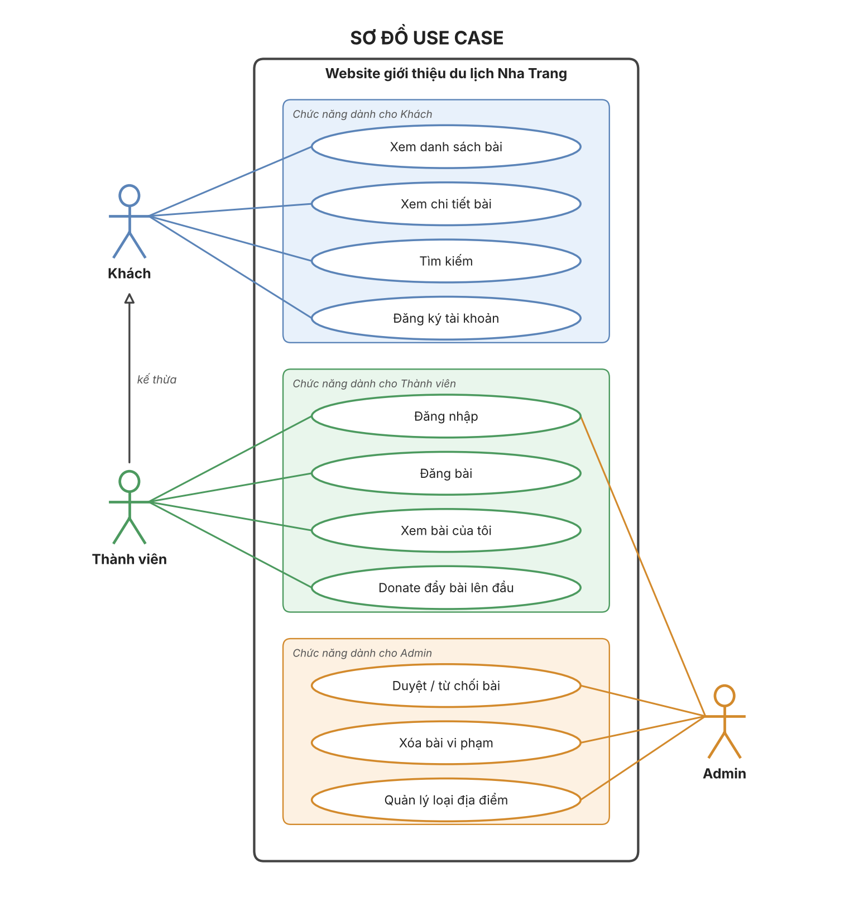

<div align="center">

# Website Giới Thiệu Du Lịch Nha Trang

**Đồ án cơ sở ngành — ASP.NET Core MVC**

Chia sẻ địa điểm, món ăn và trải nghiệm du lịch tại thành phố biển Nha Trang


</div>

---

## 1. Giới thiệu

**Website Giới Thiệu Du Lịch Nha Trang** là đồ án cơ sở ngành của sinh viên ngành Công nghệ thông tin, Trường Đại học Nha Trang.

Website cho phép **thành viên đăng bài** giới thiệu các địa điểm du lịch tại Nha Trang. Bài viết được **quản trị viên kiểm duyệt** trước khi hiển thị. Các bài đã duyệt hiển thị theo **thứ tự ngẫu nhiên**, và bài có **donate** được ưu tiên đưa lên đầu trang.

## 2. Chức năng

### Khách (chưa đăng nhập)

- Xem danh sách bài giới thiệu
- Xem chi tiết từng bài
- Tìm kiếm bài theo tên
- Đăng ký tài khoản

### Thành viên (đã đăng nhập)

- Đăng nhập
- Đăng bài (tiêu đề, mô tả, hình ảnh, loại địa điểm)
- Xem bài của mình và trạng thái (chờ duyệt, đã duyệt, từ chối)
- Donate để đẩy bài lên đầu trang *(mô phỏng, không dùng thanh toán thật)*

### Quản trị viên (Admin)

- Duyệt hoặc từ chối bài viết
- Xóa bài vi phạm
- Quản lý loại địa điểm (thêm, sửa, xóa)

## 3. Quy tắc nghiệp vụ

1. Bài mới đăng có trạng thái **Chờ duyệt**. Admin duyệt thành **Đã duyệt** hoặc **Từ chối**.
2. Trang chủ chỉ hiển thị bài **Đã duyệt**.
3. Bài có donate còn hiệu lực (`FeaturedUntil` lớn hơn thời điểm hiện tại) hiển thị ở đầu trang; các bài còn lại sắp xếp **ngẫu nhiên** mỗi lần tải trang.
4. Donate là **mô phỏng**: hệ thống lưu lượt donate và đặt `FeaturedUntil` = hôm nay + 7 ngày, không xử lý giao dịch tiền thật.
5. Chỉ Admin vào được trang quản trị. Chỉ thành viên đã đăng nhập mới được đăng bài và donate.
6. Mật khẩu lưu dưới dạng **hash**, không lưu chữ thường.

## 4. Công nghệ sử dụng

| Thành phần | Công nghệ |
| --- | --- |
| Nền tảng | ASP.NET Core MVC (.NET 10) |
| Ngôn ngữ | C# |
| Cơ sở dữ liệu | SQL Server LocalDB |
| Truy cập dữ liệu | Entity Framework Core 10.0.15 (Code First + Migration) |
| Giao diện | HTML, CSS, Bootstrap 5, Razor |
| Quản lý mã nguồn | Git, GitHub |

## 5. Thiết kế

### Sơ đồ Use Case



### Sơ đồ ERD


### Các bảng dữ liệu

| Bảng | Mô tả | Quan hệ |
| --- | --- | --- |
| `Users` | Tài khoản người dùng và vai trò (Admin, Member) | 1 người dùng — nhiều bài viết, nhiều lượt donate |
| `Categories` | Loại địa điểm (bãi biển, di tích, ẩm thực...) | 1 loại — nhiều bài viết |
| `Posts` | Bài giới thiệu, trạng thái duyệt, hạn ưu tiên | 1 bài — nhiều lượt donate |
| `Donations` | Lịch sử donate để đẩy bài lên đầu trang | Nhiều donate — 1 bài, 1 người dùng |

## 6. Cấu trúc thư mục

```text
Website-Gioi-Thieu-Dia-Diem-Du-Lich-Nha-Trang/
├── DuLichNhaTrang.slnx         # File solution (mở bằng Visual Studio)
├── README.md                   # Giới thiệu dự án (file này)
├── .gitignore                  # Bỏ qua file rác khi commit
├── .gitattributes              # Chuẩn hóa xuống dòng, khai báo file nhị phân
├── .editorconfig               # Quy ước định dạng code
│
├── docs/                       # Tài liệu và hình ảnh thiết kế
│   ├── use-case.png            # Sơ đồ Use Case
│   ├── erd.png                 # Sơ đồ ERD
│   └── screenshots/            # Ảnh chụp màn hình (bổ sung khi hoàn thiện)
│
└── DuLichNhaTrang/             # Project ASP.NET Core MVC
    ├── Controllers/            # Nhận yêu cầu từ người dùng
    ├── Models/                 # Lớp dữ liệu: User, Category, Post, Donation
    ├── Data/                   # AppDbContext và Migrations (tạo bảng CSDL)
    │   └── Migrations/
    ├── Views/                  # Giao diện Razor (.cshtml)
    │   ├── Home/               # View của HomeController
    │   └── Shared/             # Layout, Error, Partial dùng chung
    ├── wwwroot/                # File tĩnh
    │   ├── css/
    │   ├── js/
    │   ├── lib/                # Bootstrap, jQuery
    │   └── images/             # Ảnh do thành viên tải lên
    ├── appsettings.json        # Chuỗi kết nối CSDL, cấu hình
    ├── Program.cs              # Điểm khởi động, đăng ký dịch vụ
    └── DuLichNhaTrang.csproj   # Khai báo project và các gói NuGet
```

### Luồng xử lý MVC

| Người dùng truy cập | Controller nhận | Gọi dữ liệu | Trả về View |
| --- | --- | --- | --- |
| `/Home/Index` | `HomeController.Index()` | `AppDbContext` (nếu cần) | `Views/Home/Index.cshtml` |
| `/Post/Details/5` | `PostController.Details(5)` | Bảng `Posts` | `Views/Post/Details.cshtml` |

## 7. Quy ước code

- **Controller**: đặt tên `XxxController` (ví dụ `PostController`).
- **View**: `Views/TenController/TenAction.cshtml` (ví dụ `Views/Post/Index.cshtml`).
- **Model**: số ít, PascalCase (`User`, `Post`); tên cột giữ nguyên tiếng Việt không dấu (`TieuDe`, `NgayDang`).
- **Trạng thái bài viết**: `ChoDuyet`, `DaDuyet`, `TuChoi`.
- **Vai trò**: `Admin`, `Member`.
- **Ảnh tải lên**: lưu file trong `wwwroot/images`, chỉ lưu **tên file** vào cột `Posts.HinhAnh`.
- **Không commit**: `bin/`, `obj/`, `.vs/`, `*.user` (đã khai báo trong `.gitignore`).
- **Commit**: mỗi chức năng hoàn thành thì commit một lần, thông điệp bằng tiếng Việt.

## 8. Hướng dẫn chạy

**Yêu cầu:** Visual Studio 2026 (có gói *ASP.NET and web development*) và SQL Server LocalDB.

```bash
# 1. Tải mã nguồn
git clone https://github.com/trunglmtech/Website-Gioi-Thieu-Dia-Diem-Du-Lich-Nha-Trang.git

# 2. Mở file solution
#    Mở DuLichNhaTrang.slnx bằng Visual Studio
```

3. Kiểm tra chuỗi kết nối trong `DuLichNhaTrang/appsettings.json`.
4. Tạo cơ sở dữ liệu bằng migration (chỉ cần làm lần đầu):

```bash
dotnet tool install --global dotnet-ef   # cài công cụ EF Core (nếu chưa có)
cd DuLichNhaTrang
dotnet ef database update
```

5. Nhấn **F5** để chạy website.

> Cơ sở dữ liệu **không** lưu trong GitHub. Máy mới chỉ cần chạy `dotnet ef database update` là có đủ bảng.

## 9. Tiến độ

- [x] Chọn đề tài, tạo repository và project ASP.NET Core MVC
- [x] Phân tích yêu cầu, vẽ sơ đồ Use Case và ERD
- [x] Tạo Models, DbContext và cơ sở dữ liệu
- [ ] Đăng ký, đăng nhập, phân quyền
- [ ] Xem danh sách, xem chi tiết, tìm kiếm
- [ ] Đăng bài và quản lý bài của tôi
- [ ] Admin duyệt bài, quản lý loại địa điểm
- [ ] Hiển thị ngẫu nhiên và donate mô phỏng
- [ ] Kiểm thử và hoàn thiện
- [ ] Báo cáo và demo

## 10. Tác giả

**Trung** — Sinh viên Công nghệ thông tin (chuyên ngành Công nghệ phần mềm), Trường Đại học Nha Trang.

Đồ án cơ sở ngành, thực hiện dưới sự hướng dẫn của giảng viên bộ môn.

## 11. Ghi chú

Sản phẩm phục vụ mục đích học tập. Chức năng donate chỉ là **mô phỏng**, không xử lý giao dịch tiền thật.
