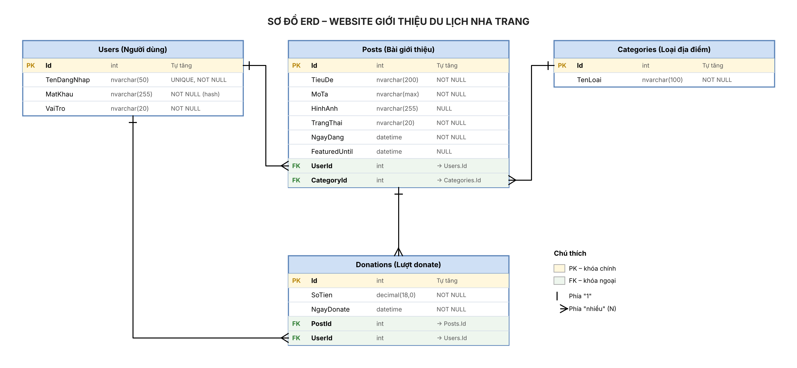

<div align="center">

# Website Giới Thiệu Du Lịch Nha Trang

**Đồ án cơ sở ngành — ASP.NET Core MVC**

Chia sẻ địa điểm, món ăn và trải nghiệm du lịch tại thành phố biển Nha Trang


</div>

---

## 1. Giới thiệu

**Website Giới Thiệu Du Lịch Nha Trang** là đồ án cơ sở ngành của sinh viên ngành Công nghệ thông tin, Trường Đại học Nha Trang.

Website cho phép **thành viên đăng bài** giới thiệu các địa điểm du lịch tại Nha Trang. Bài viết được **quản trị viên kiểm duyệt** trước khi hiển thị. Các bài đã duyệt hiển thị theo **thứ tự ngẫu nhiên**, và bài có **donate** được ưu tiên đưa lên đầu trang.

## 2. Chức năng

### Khách (chưa đăng nhập)

- Xem danh sách bài giới thiệu
- Xem chi tiết từng bài
- Tìm kiếm bài theo tên
- Đăng ký tài khoản

### Thành viên (đã đăng nhập)

- Đăng nhập
- Đăng bài (tiêu đề, mô tả, hình ảnh, loại địa điểm)
- Xem bài của mình và trạng thái (chờ duyệt, đã duyệt, từ chối)
- Donate để đẩy bài lên đầu trang *(mô phỏng, không dùng thanh toán thật)*

### Quản trị viên (Admin)

- Duyệt hoặc từ chối bài viết (khi từ chối phải nhập lý do)
- Xóa bài vi phạm
- Quản lý loại địa điểm (thêm, sửa, xóa)

## 3. Quy tắc nghiệp vụ

1. Bài mới đăng có trạng thái **Chờ duyệt**. Admin duyệt thành **Đã duyệt** hoặc **Từ chối**.
   Khi từ chối, Admin **bắt buộc nhập lý do**; lý do này hiện cho thành viên ở mục **Bài của tôi**.
   Nếu bài bị từ chối được duyệt lại thì lý do cũ bị xóa.
2. Trang chủ chỉ hiển thị bài **Đã duyệt**.
3. Bài có donate còn hiệu lực (`FeaturedUntil` lớn hơn thời điểm hiện tại) hiển thị ở đầu trang; các bài còn lại sắp xếp **ngẫu nhiên** mỗi lần tải trang.
4. Donate là **mô phỏng**: hệ thống lưu lượt donate và đặt `FeaturedUntil` = hôm nay + 7 ngày, không xử lý giao dịch tiền thật.
5. Chỉ Admin vào được trang quản trị. Chỉ thành viên đã đăng nhập mới được đăng bài và donate.
6. Mật khẩu lưu dưới dạng **hash**, không lưu chữ thường.
7. Tên loại địa điểm **không được trùng**, tối đa 100 ký tự.
8. **Không xóa được loại địa điểm** đang có bài viết; phải xóa hoặc chuyển các bài đó sang loại khác trước.

## 4. Công nghệ sử dụng

| Thành phần | Công nghệ |
| --- | --- |
| Nền tảng | ASP.NET Core MVC (.NET 10) |
| Ngôn ngữ | C# |
| Cơ sở dữ liệu | SQL Server Express (quản lí bằng SSMS) |
| Truy cập dữ liệu | Entity Framework Core 10.0.15 (Code First + Migration) |
| Giao diện | HTML, CSS, Bootstrap 5, Razor |
| Quản lý mã nguồn | Git, GitHub |

## 5. Thiết kế

### Sơ đồ Use Case


### Sơ đồ ERD



### Các bảng dữ liệu

| Bảng | Mô tả | Quan hệ |
| --- | --- | --- |
| `Users` | Tài khoản người dùng và vai trò (Admin, Member) | 1 người dùng — nhiều bài viết, nhiều lượt donate |
| `Categories` | Loại địa điểm (điểm vui chơi, ăn uống, tham quan, nghỉ dưỡng, cà phê) | 1 loại — nhiều bài viết |
| `Posts` | Bài giới thiệu, trạng thái duyệt, lý do từ chối, hạn ưu tiên | 1 bài — nhiều lượt donate |
| `Donations` | Lịch sử donate để đẩy bài lên đầu trang | Nhiều donate — 1 bài, 1 người dùng |

## 6. Cấu trúc thư mục

```text
Website-Gioi-Thieu-Dia-Diem-Du-Lich-Nha-Trang/
├── DuLichNhaTrang.slnx         # File solution (mở bằng Visual Studio)
├── README.md                   # Giới thiệu dự án (file này)
├── .gitignore                  # Bỏ qua file rác khi commit
├── .gitattributes              # Chuẩn hóa xuống dòng, khai báo file nhị phân
├── .editorconfig               # Quy ước định dạng code
│
├── database/                   # File CSDL (tự sinh khi chạy, không commit)
│   ├── DuLichNhaTrang.mdf      # Dữ liệu chính (gắn vào SQL Server Express)
│   ├── DuLichNhaTrang_log.ldf  # File log của SQL Server
│   └── README.md               # Hướng dẫn mở bằng SSMS, sao lưu / khôi phục
│
├── docs/                       # Tài liệu và hình ảnh thiết kế
│   ├── use-case.png            # Sơ đồ Use Case
│   ├── erd.png                 # Sơ đồ ERD
│   └── screenshots/            # Ảnh chụp màn hình (bổ sung khi hoàn thiện)
│
└── DuLichNhaTrang/             # Project ASP.NET Core MVC
    ├── Controllers/            # Nhận yêu cầu từ người dùng
    ├── Models/                 # Lớp dữ liệu: User, Category, Post, Donation
    │   └── ViewModels/         # Dữ liệu form đăng ký, đăng nhập, đăng bài
    ├── Data/                   # AppDbContext, SeedData và Migrations
    │   └── Migrations/
    ├── Views/                  # Giao diện Razor (.cshtml)
    │   ├── Account/            # Đăng ký, đăng nhập, báo lỗi quyền
    │   ├── Admin/              # Trang quản trị
    │   ├── Home/               # Trang chủ, chi tiết bài
    │   ├── Post/               # Đăng bài, bài của tôi
    │   └── Shared/             # Layout, Error, Partial dùng chung
    ├── wwwroot/                # File tĩnh
    │   ├── css/
    │   ├── js/
    │   ├── lib/                # Bootstrap, jQuery, Quill (soạn thảo mô tả)
    │   └── images/
    │       ├── sample/         # Ảnh mẫu, xem NGUON-ANH.md để biết nguồn và giấy phép
    │       └── posts/          # Ảnh do thành viên tải lên (tự sinh, không commit)
    ├── appsettings.json        # Chuỗi kết nối CSDL, cấu hình
    ├── Program.cs              # Điểm khởi động, đăng ký dịch vụ
    └── DuLichNhaTrang.csproj   # Khai báo project và các gói NuGet
```

### Luồng xử lý MVC

| Người dùng truy cập | Controller nhận | Gọi dữ liệu | Trả về View |
| --- | --- | --- | --- |
| `/` hoặc `/?q=biển` | `HomeController.Index(q)` | Bảng `Posts` + `Categories` | `Views/Home/Index.cshtml` |
| `/Home/Details/5` | `HomeController.Details(5)` | Bảng `Posts` + `Categories` + `Users` | `Views/Home/Details.cshtml` |
| `/Post/Create` | `PostController.Create()` | Bảng `Categories`, lưu ảnh vào `wwwroot/images/posts` | `Views/Post/Create.cshtml` |
| `/Post/MyPosts` | `PostController.MyPosts()` | Bảng `Posts` + `Categories` (lọc theo `UserId`) | `Views/Post/MyPosts.cshtml` |
| `/Admin` | `AdminController.Index(trangThai)` | Bảng `Posts` + `Categories` + `Users` | `Views/Admin/Index.cshtml` |
| `/Admin/ChiTiet/5` | `AdminController.ChiTiet(5)` | Bảng `Posts` + `Categories` + `Users` | `Views/Admin/ChiTiet.cshtml` |
| `POST /Admin/Duyet/5` | `AdminController.Duyet(5)` | Cập nhật `Posts.TrangThai` | Chuyển về `Views/Admin/Index.cshtml` |
| `/Admin/LoaiDiaDiem` | `AdminController.LoaiDiaDiem()` | Bảng `Categories` + `Posts` (đếm số bài) | `Views/Admin/LoaiDiaDiem.cshtml` |
| `POST /Admin/ThemLoai` | `AdminController.ThemLoai(model)` | Thêm dòng vào `Categories` | Chuyển về `Views/Admin/LoaiDiaDiem.cshtml` |
| `POST /Admin/SuaLoai` | `AdminController.SuaLoai(model)` | Sửa `Categories.TenLoai` | Chuyển về `Views/Admin/LoaiDiaDiem.cshtml` |
| `POST /Admin/XoaLoai/5` | `AdminController.XoaLoai(5)` | Kiểm tra `Posts`, xóa `Categories` | Chuyển về `Views/Admin/LoaiDiaDiem.cshtml` |

## 7. Quy ước code

- **Controller**: đặt tên `XxxController` (ví dụ `PostController`).
- **View**: `Views/TenController/TenAction.cshtml` (ví dụ `Views/Post/Index.cshtml`).
- **Model**: số ít, PascalCase (`User`, `Post`); tên cột giữ nguyên tiếng Việt không dấu (`TieuDe`, `NgayDang`).
- **Trạng thái bài viết**: `ChoDuyet`, `DaDuyet`, `TuChoi`.
- **Lý do từ chối**: lưu ở cột `Posts.LyDoTuChoi` (tối đa 500 ký tự, có thể để trống với bài chưa bị từ chối).
- **Vai trò**: `Admin`, `Member`.
- **Ảnh tải lên**: lưu file trong `wwwroot/images/posts`, lưu **đường dẫn tương đối** vào cột `Posts.HinhAnh` (ví dụ `images/posts/abc123.jpg`).
- **Mô tả bài viết**: lưu **HTML có định dạng** (in đậm, in nghiêng, cỡ chữ theo px, danh sách...) do trình soạn thảo Quill tạo ra. Trước khi lưu, HTML được lọc bằng thư viện `HtmlSanitizer` để bỏ thẻ độc hại (`<script>`, `onerror`...), nhưng vẫn giữ thuộc tính `font-size`.
- **Không commit**: `bin/`, `obj/`, `.vs/`, `*.user` (đã khai báo trong `.gitignore`).
- **Commit**: mỗi chức năng hoàn thành thì commit một lần, thông điệp bằng tiếng Việt.

## 8. Hướng dẫn chạy

**Yêu cầu:** Visual Studio 2026 (có gói *ASP.NET and web development*), SQL Server Express và SQL Server Management Studio (SSMS) để xem/sửa dữ liệu.

```bash
# 1. Tải mã nguồn
git clone https://github.com/trunglmtech/Website-Gioi-Thieu-Dia-Diem-Du-Lich-Nha-Trang.git

# 2. Mở file solution
#    Mở DuLichNhaTrang.slnx bằng Visual Studio
```

3. Kiểm tra chuỗi kết nối trong `DuLichNhaTrang/appsettings.json`. Đường dẫn `AttachDbFilename` phải trỏ tới thư mục `database/` trên máy đang chạy, còn `Server` phải là `.\SQLEXPRESS` (SQL Server Express trên máy).
4. Nhấn **F5**. Lần chạy đầu tiên, Entity Framework tự tạo file CSDL `database/DuLichNhaTrang.mdf` và thêm dữ liệu mẫu.

   Nếu muốn tạo CSDL trước bằng dòng lệnh:

   ```bash
   dotnet tool install --global dotnet-ef   # cài công cụ EF Core (nếu chưa có)
   cd DuLichNhaTrang
   dotnet ef database update
   ```

> File `.mdf` / `.ldf` **không** đưa lên GitHub vì là dữ liệu riêng của từng máy. Máy mới chỉ cần chạy website một lần là có CSDL. Cách sao lưu / khôi phục: xem `database/README.md`.

### Quản lí dữ liệu bằng SSMS

CSDL `DuLichNhaTrang` được **gắn (attach)** vào **SQL Server Express** trên máy, nên mở được trực tiếp bằng SSMS:

1. Mở **SQL Server Management Studio**.
2. Ở hộp **Connect to Server**:
   - **Server type**: Database Engine
   - **Server name**: `.\SQLEXPRESS` (nếu không kết nối được thì thử `localhost\SQLEXPRESS`)
   - **Authentication**: Windows Authentication
3. Bấm **Connect** → mở **Databases** → chọn `DuLichNhaTrang` → mở **Tables**.
4. Chuột phải bảng cần xem:
   - **Select Top 1000 Rows**: xem dữ liệu
   - **Edit Top 200 Rows**: sửa trực tiếp (sửa xong nhấn **Ctrl + S** để lưu)

| Bảng | Dùng để xem / sửa |
| --- | --- |
| `dbo.Users` | Tài khoản và vai trò (`Admin` / `Member`) |
| `dbo.Categories` | Loại địa điểm |
| `dbo.Posts` | Bài viết, trạng thái duyệt, lý do từ chối, hạn ưu tiên |
| `dbo.Donations` | Lịch sử donate mô phỏng |

> ⚠️ Cột `Users.MatKhau` là **mật khẩu đã hash**, không phải chữ thường. Đừng gõ mật khẩu mới vào cột này — tài khoản sẽ không đăng nhập được. Muốn thêm tài khoản thì dùng trang **Đăng ký** của website.

Một số câu lệnh hay dùng: chọn CSDL `DuLichNhaTrang` → **New Query** → dán câu lệnh → **Execute (F5)**.

```sql
-- Xem toàn bộ bài viết kèm trạng thái
SELECT Id, TieuDe, TrangThai, LyDoTuChoi, NgayDang FROM dbo.Posts ORDER BY Id;

-- Duyệt tất cả bài đang chờ
UPDATE dbo.Posts SET TrangThai = N'DaDuyet', LyDoTuChoi = NULL WHERE TrangThai = N'ChoDuyet';

-- Đẩy một bài lên đầu trang 7 ngày (donate mô phỏng)
UPDATE dbo.Posts SET FeaturedUntil = DATEADD(DAY, 7, GETDATE()) WHERE Id = 6;
```

> Chỉ nên sửa dữ liệu trực tiếp trong SSMS khi demo hoặc sửa dữ liệu mẫu. Khi website đang chạy, nên thao tác qua giao diện để đúng quy tắc nghiệp vụ (ví dụ: duyệt bài, donate).

### Tài khoản mẫu

Khi chạy lần đầu, hệ thống tự tạo dữ liệu mẫu (5 loại địa điểm, 6 bài viết, 1 lượt donate) và 2 tài khoản:

| Vai trò | Tên đăng nhập | Mật khẩu |
| --- | --- | --- |
| Quản trị viên | `admin` | `123456` |
| Thành viên | `trung` | `123456` |

> Tài khoản trên chỉ dùng cho mục đích demo đồ án. Mật khẩu được lưu dưới dạng hash.

## 9. Tiến độ

- [x] Chọn đề tài, tạo repository và project ASP.NET Core MVC
- [x] Phân tích yêu cầu, vẽ sơ đồ Use Case và ERD
- [x] Tạo Models, DbContext và cơ sở dữ liệu
- [x] Thêm dữ liệu mẫu (loại địa điểm, bài viết, tài khoản)
- [x] Đăng ký, đăng nhập, đăng xuất và phân quyền Admin/Member
- [x] Xem danh sách, xem chi tiết, tìm kiếm (giao diện theo phong cách Travello)
- [x] Đăng bài và quản lý bài của tôi
- [x] Admin duyệt, từ chối, xóa bài
- [x] Admin quản lý loại địa điểm
- [ ] Hiển thị ngẫu nhiên và donate mô phỏng
- [ ] Kiểm thử và hoàn thiện
- [ ] Báo cáo và demo

## 10. Tác giả

**Trung** — Sinh viên Công nghệ thông tin (chuyên ngành Công nghệ phần mềm), Trường Đại học Nha Trang.

Đồ án cơ sở ngành, thực hiện dưới sự hướng dẫn của giảng viên bộ môn.

## 11. Ghi chú

Sản phẩm phục vụ mục đích học tập. Chức năng donate chỉ là **mô phỏng**, không xử lý giao dịch tiền thật.

- Giao diện lấy cảm hứng từ mẫu Figma **Travello – Traveling Website Landing Page**
  (<https://www.figma.com/community/file/1230410907606513611/travello-traveling-website-landing-page>),
  dựng lại bằng **Bootstrap 5** có sẵn trong project, không copy file của template.
- Ảnh minh hoạ lấy từ Wikimedia Commons; danh sách tác giả và giấy phép ghi trong
  `DuLichNhaTrang/wwwroot/images/sample/NGUON-ANH.md`.
- Trình soạn thảo mô tả dùng **Quill 2** (giấy phép BSD-3), chép sẵn vào `wwwroot/lib/quill`
  nên **không cần mạng** khi chạy demo. Giấy phép gốc nằm trong thư mục đó.
